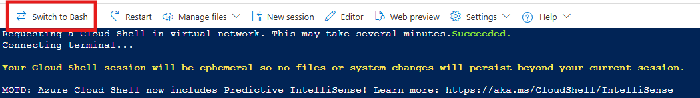
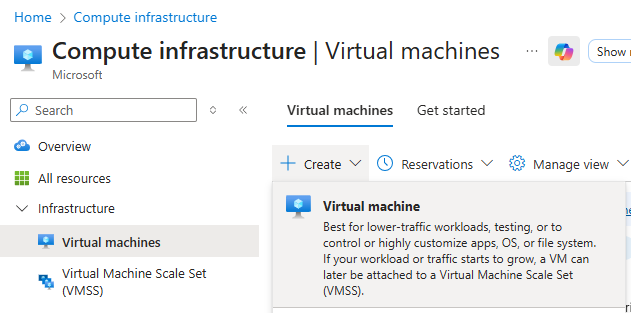
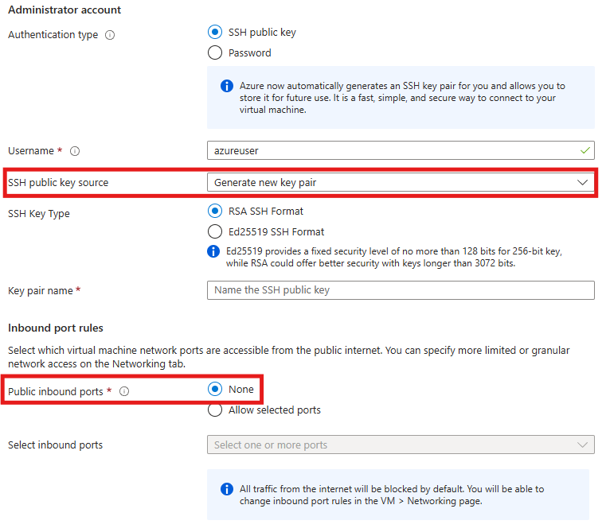
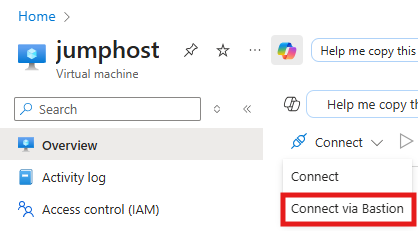
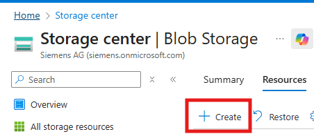
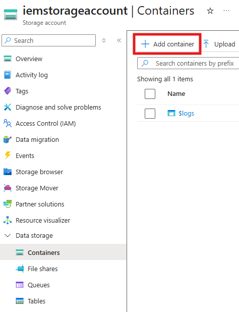

# Cluster creation

For this setup both the [Azure Portal](https://portal.azure.com/) and the [Azure Cloud Shell](https://learn.microsoft.com/en-us/azure/cloud-shell/get-started/classic?toc=%2Fcli%2Fazure%2Ftoc.json&bc=%2Fcli%2Fazure%2Fbreadcrumb%2Ftoc.json&tabs=azurecli) + [Azure CLI](https://learn.microsoft.com/en-us/cli/azure/) will be used. CLI can also be used directly from the host machine as an alternative to the Cloud Shell. In this case refer to [How to install the Azure CLI](https://learn.microsoft.com/en-us/cli/azure/install-azure-cli) for the installation of the CLI.

## Launching Azure Cloud Shell

Login to the [Azure Portal](https://portal.azure.com/) and launch the Azure Cloud Shell from the top bar:


In case the Cloud Shell is launching a Powershell terminal make sure to switch to Bash before proceeding with this guide:



The Azure Cloud Shell is automatically authenticated under the initial account signed-in with to the Azure Portal.

> **_Notice_**:  
Use `az login` to login with a different account if needed.
</br>E.g. `az login --service-principal -u $CLIENT_ID -p $SECRET_VALUE --tenant $TENANT_ID` for using a [service principal](https://learn.microsoft.com/en-us/azure/databricks/admin/users-groups/service-principals).
</br>This guide continues with the automatically authenticated user.

Before continuing with this guide it is recommended to confirm the correct subscription is selected.

1. To view the currently selected subscription run:

    ```bash
    az account show -o table
    ```

2. To change the selected subscription list all available subscriptions the logged in user can use by running:

    ```bash
    az account list -o table
    ```

3. And set the subsciption run:
  
    ```bash
    SUBSCRIPTION_ID=<subscription id>
  
    az account set --subscription $SUBSCRIPTION_ID
    ```

## AKS cluster creation

As a first setup in the creation of an Azure Kubernetes Service (AKS) it is recommended to create a dedicated `Resource group` for the kubernetes cluster. When using the [Azure CLI](https://learn.microsoft.com/en-us/cli/azure/) is used a `Resource group` can be created using the following command:

```bash
LOCATION=<name of the azure location, e.g. northeurope>
RESOURCE_GROUP=<name of the resource group>

az group create --location $LOCATION --resource-group $RESOURCE_GROUP
```

> **_Hint_**:  
All available location / region names can be checked in the 'Name' column after executing:  
`az account list-locations -o table`

Inside of the created `Resource group` the AKS cluster will be created.

> **_Notice**:  
Normally, the Azure native application gateway could be used, and would be created directly together with the cluster itself. However this is not recommended since there is a hard coded [limit](https://learn.microsoft.com/en-us/azure/azure-resource-manager/management/azure-subscription-service-limits#application-gateway-limits) for uploaded files of 4Gb, which would affect the proper behaviour of certain functions (e.g. import/upload of larger apps, IED backups, etc.).

To create the cluster without the Application Gateway Ingress Controller (AGIC), the following command can be used:

```bash
CLUSTER_NAME=<name of the aks>

az aks create \
--name $CLUSTER_NAME \
--resource-group $RESOURCE_GROUP \
--network-plugin azure \
--enable-managed-identity \
--enable-private-cluster \
--node-vm-size Standard_D4s_v3 \
--enable-cluster-autoscaler \
--min-count 2 \
--max-count 5 \
--generate-ssh-keys
```

The following table will briefly cover the flags used for this command:

| Command | Description |
| --- | --- |
| az aks create | Starts process of creating the AKS cluster |
|  --name $CLUSTER_NAME | Name of the cluster |
|  --resource-group $RESOURCE_GROUP | Name of the previously created resource group where the cluster will be created in|
|  --network-plugin azure | Installation of the Azure networking plugin into the AKS cluster |
|  --enable-managed-identity | This enables the use of a managed identity for the AKS cluster, which simplifies the management of permissions and access to other Azure resources |
|  --enable-private-cluster | The Kubernetes API server will only be accessible from within the virtual network |
|  --node-vm-size Standard_D4s_v3 | VM template for AKS cluster worker nodes. This value can be adjusted depending on the needs |
|  --enable-cluster-autoscaler | Enables the automatic scaling of VM nodes if additional resources are required. Each additional node will also increase the costs |
|  --min-count 2 | Minimum number of 'Standard_D4s_v3' worker nodes of the AKS cluster |
|  --max-count 5 | Maximum number of 'Standard_D4s_v3' worker nodes of the AKS cluster |
|  --generate-ssh-keys | Generation of SSH keys for secure communication within the AKS cluster |

> **_Notice_**  
The actual cluster resources (Nodes, Ingress, PVCs, etc.) will be generated in an automatically created `Resource group` with the following naming convention `MC_$RESOURCE_GROUP_$CLUSTER_NAME_$LOCATION`. The overall process of the AKS cluster creation might take around 10 to 20 minutes.  
The reason for this second resource group is to organize and manage the resources that are required for the AKS cluster to function, such as virtual machines, networking components, and storage, without cluttering the resource group where you might have other resources. This automatic creation helps in managing the lifecycle of the AKS cluster, as deleting the cluster will also clean up the associated resources in this separate resource group. This design ensures that the infrastructure resources are isolated and managed independently, providing a cleaner and more organized resource management experience.

## Creation of a jumphost VM to access the cluster

It is a general best practice to not expose virtual machines running in cloud environments directly to the internet. Therefore the AKS cluster has been created as a private cluster. With this configuration the individual worker nodes can't be accessed directly and a jumphost virtual machine inside of this virtual network is needed as a way of accessing the cluster.

> **_Notice_**:
The virtual machine acting as a jumphost will not require that many resources. A standard Linux VM (e.g. Ubuntu Server 24.04 LTS) with the default size and Standard SSD disks will be more than enough for this. However it is also possible to check [other sizes](https://azure.microsoft.com/en-us/pricing/details/virtual-machines/series/) for the VM with less resources to lower the costs.

For the jumphost creation navigate to the [Azure Portal](https://portal.azure.com/) and search for `Virtual machines`.



Afterwards create a virtual machine with the following settings:

- Resource Group: `MC_$RESOURCE_GROUP_$CLUSTER_NAME_$LOCATION` (the automatically created resource group with the cluster resources)
- 'SSH public key source': 'Generte new key pair'
- 'Public inbound ports': 'None'
- Ensure the VM uses the same virtual network as the cluster.



The VM is created without public inbound ports so that it is not directly expose the VM to the internet as well. To establish a secure connection to the jumphost a Azure `Bastion` will be used.
Navigate to the jumphost in the Azure Portal and start the VM. Afterwards select the connection method 'Connect via Bastion' as shown below.



As the authentication type for the bastion choose 'SSH Private Key from Local File'. Input the username and the key file that was downloaded during the creation of the VM and click on 'Connect'. After a short while a terminal to the jumphost should open in a new window.

## Setup of the jumphost VM

After successfully logging in to the jumphost, go ahead with installing the Azure CLI, kubectl and [Helm CLI](https://helm.sh/) on it.

```bash
curl -sL https://aka.ms/InstallAzureCLIDeb | sudo bash

sudo az aks install-cli

curl https://raw.githubusercontent.com/helm/helm/main/scripts/get-helm-3 | bash
```

> **_Notice_**:  
Please refer to the [offical Helm website](https://helm.sh) for detailed information on the installation of helm.

With these required tools installed login to the Azure CLI using a device code:

```bash
az login --use-device-code
```

> **_Hints_**:  
Depending on the configration of the Azure environment it might not be allowed to use a device code for login. IN this case a Service Principal could be used:  
`az login --service-principal -u $CLIENT_ID -p $CLIENT_SECERT --tenant $TENANT_ID`  
Please refer to [Authenticate to Azure using Azure CLI](https://learn.microsoft.com/en-us/cli/azure/authenticate-azure-cli) for more infos on the different authentication methods for the Azure CLI.

After logging in make sure the correct subscription is selectec by using the same commands as explained in [Launching the Azure Cloud Shell](#1-launching-the-azure-cloud-shell)

With the correct subscription selected the access credentials for the AKS cluster can be saved to your kubectl configuration using the following the Azure CLI command on your jumphost. Make sure to set the require environment variables before executing the command:

```bash
az aks get-credentials --name $CLUSTER_NAME --resource-group $RESOURCE_GROUP --overwrite-existing
```

## Setup of an Storage account for file transfer

Since files can't be directy copied to the jumphost it is recommended to create a `Storage account` for the file transfer between host machine and jumphost. Therefore go to the Azure Portal and search for `Storage accounts`.



No special settings need to be configured for this, so the new storage account can be created with default values. After the creation of the storage account is done, create a container within the Storage account where the uploaded files will be stored.



In the scope of this guide this container is used to transfer the following files to the jumphost:

- IEM config.json file (onboarding file)
- generated certificates and private key for the IEM

How these files can be optained will be explained in the section [Setup IEM Pro on AKS](#setup-iem-pro-on-aks).

To upload files to the created container in the storage class, navigate to the container in the Azure Portal and click on upload.
Uploaded files can be download to the jumphost using the following command:

```bash
STORAGE_ACCOUNT_NAME=<name of the storage account>
CONTAINER_NAME=<name of the container inside the storage account>
FILE_NAME=<name of the file whish should be downloaded>

az storage blob download --account-name $STORAGE_ACCOUNT_NAME --container-name $CONTAINER_NAME --name $FILE_NAME --file ~/$FILE_NAME
```

While the parameter `--file` is representing where the new file will be located in the jumphost after the download from the storage class.  
With this your infrastructure should be ready for the setup of an IEM.

> **_Hint:_** While a storage account is the way presented and followed by the guide, it is by no means the only way to transfer the files to the VM. It is also possible, for example, to transfer these files by using other tools such as WinSCP.
It is also possible to do "Drag & Drop" with Visual Studio Code, but this would require an SSH remote connection.