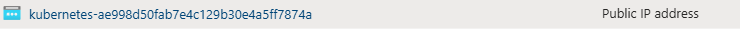

# Setup IEM Pro on AKS

## Ingress Controller Deployment

To expose the IEM to external network a [traefik](https://traefik.io/) Ingress will be used. Please refer to the [offical traefik website](https://traefik.io/) for more detailed information on traefik and the [installation options](https://doc.traefik.io/traefik/getting-started/install-traefik/#use-the-helm-chart). For this guide the installation will be done using helm.

1. Add Traefik Labs chart repository to Helm:

    ```bash
    helm repo add traefik https://traefik.github.io/charts
    ```

2. Update the repository and install traefik using:

    ```bash
    helm repo update
    helm install traefik traefik/traefik
    ```

After this process has completed, a new public IP resource will have been created in the resource group where the VM is located (`MC_$RESOURCE_GROUP_$CLUSTER_NAME_$LOCATION`). It will be named similar to the following:



To finish up the deployment of the ingress controller, select this newly created Public IP address in the [Azure Portal](https://portal.azure.com/), navigate to "Settings > Configuration" and set the Subject Alternative Name (SAN) of the DNS.

> **_Important note_**:  
Since this guide will not cover the configuration of an customized Private DNS zone on Azure, the final URL for the DNS that is given will include the suffix ".$LOCATION.cloudapp.azure.com" and the DNS will be something similar to "my-iem.northeurope.cloudapp.azure.com".

## Generate Certificates for the FQDN of your ingress

Generate your own certificates for the DNS name set in the previous step or use the following files [gen_with_ca_DNS.sh](./Example_Docs/gen_with_ca_DNS.sh), [rootCert.conf](./Example_Docs/rootCert.conf), [intermediateCert.conf](./Example_Docs/intermediateCert.conf), [intermediateCert-ext.conf](./Example_Docs/intermediateCert-ext.conf), [serverCert.conf](./Example_Docs/serverCert.conf) and [serverCert-ext.conf](./Example_Docs/serverCert-ext.conf) to generate a certificate chain consisting of root certificate, intermediate certificate and server certificate using openssl with sample data:

```bash
HOSTNAME=<FQDN of the IEM: e.g. my-iem.northeurope.cloudapp.azure.com>

sudo chmod +x gen_with_ca_DNS.sh
./gen_with_ca_DNS.sh $HOSTNAME
```

Make sure that the generated certificates and keys are transfered to the jumphost, using the [storage account](#5-setup-of-an-storage-account-for-file-transfer), before continuing with the guide.

## Store the certicates as secret in the AKS cluster

First create a namespace for the IEM:

```bash
NAMESPACE=iem

kubectl create namespace $NAMESPACE
```

Afterwards create a secret containing the IEM gateway certificates. This TLS secret should contain the private key of the server certificate and server certificate of the IEM, including all intermediate certificates for easier trust management.

```bash
SECRET_NAME=iemcert
PATH_TO_CERT=./out/chain_without_rootCert.crt
PATH_TO_KEY=./out/serverCert.key

kubectl create --namespace $NAMESPACE secret tls $SECRET_NAME --cert=$PATH_TO_CERT --key=$PATH_TO_KEY
```

> **_Hint:_**:  
If the certificate gernation files have been used the environment variables can be used as shown in the code snippet.

## Create an IEM instance in the IEHub

1. Log into the [Industrial Edge Hub](https://iehub.eu1.edge.siemens.cloud/).

2. Navigate to `IEM Instances` and click `Create New IEM Instance`.

3. Enter the name for the IEM instance.

    Optional a description and contact information can be provided as well.

4. Click `Save`.

    The IEM instance has been created.

5. Click the download icon to download the configuration file of the newly created IEM instance. This file will be used for the onboarding of an IEM instance against the Industrial Edge Hub

  

  > **_Hint:_**  
  After downloading, the configuration file is valid only for 1 hour

  Make sure that the downloaded configration file (onboarding file) is transfered to the jumphost, before continuing with the guide.

## Installation of the IEM instance

1. Adding the public Helm repository for the IEM using this command:

    ```bash
    helm repo add iehub https://repo.portal.eu1.edge.siemens.cloud/public-v2
    ```

    This adds the repository under the name of `iehub`.
    The name can be freely chosen but please note that all further steps in the documentation will use the name `iehub`.
    If a different name has been used all following commands have to be adapted accordingly.

2. Verify that the repository has been added with the name `iehub` as `iehub/ie-management`, by checking out the latest available chart:

    ```bash
    helm repo update iehub
    helm search repo iehub/ie-management
    ```

    > **_Notice_** To list all available charts run `helm search repo iehub/ie-management --versions`

3. Install the IEM Pro on the AKS cluster with FQDN hostname

    For a better identification of the IEM deployment from other deployments a release name will be provided during the installation:

    ```bash
    RELEASE_NAME=myiem
    ```

    In order to establish a unique connection between the IEM instance and the IEHub the [previously created onboarding file](#4-create-an-iem-instance-in-the-iehub) will be provided during the installation:

    ```bash
    PATH_TO_IEM_CONFIG=config.json
    ```

    > **_Notice_**  
    Ensure to provide the path to your IEM configuration file instead of the `config.json`.
    </br>Example: `./configuration-1a457v7cjndhvhjcn843.json`

    If the server certifcate of the IEM is not public trusted, as it is the case when following this guide, the root certificate of the certificate chain has to be provided to the IEM during installation.
    Otherwise Industrial Edge Devices (IEDs) won't be able to establish a trusted connection to the IEM during the onboarding of an IED.

    ```bash
    PATH_TO_CHAIN=./out/rootCert.crt 
    ```

    To request additional information during the installation the `--debug` flag is added to the installation command.</br>
    Furthermore the timeout setting of the Helm installation is set to 30 minutes using the paramter `--timeout 30m0s`, since the default timeout of 5m0s might be too short for the installation to fully complete on some systems.

    ```bash
    helm install $RELEASE_NAME iehub/ie-management \
    --namespace iem \
    --set-file global.activationConfig=$PATH_TO_IEM_CONFIG \
    --set global.hostname=$HOSTNAME \
    --set global.storageClassPg="default" \
    --set global.storageClass="default" \
    --set global.certChain="$(cat $PATH_TO_CHAIN | base64 -w 0)" \
    --set global.gateway.ingress.enabled=false \
    --debug \
    --timeout 30m0s
    ```

    Explanation of the installation parameters:

  | Parameter | Explanation | Example Value |
  | --- | --- | --- |
  | --set-file global.activationConfig | Path to your IEM onboarding file downloaded in step [Create an IEM Instance in the Industrial Edge Hub](#4-create-an-iem-instance-in-the-iehub) for the activation of the IEM | ./onfiguration-1a457v7cjndhvhjcn843.json |
  | --set global.hostname | Enter the FQDN (Fully Qualified Domain Name) of your cluster | my-iem.northeurope.cloudapp.azure.com |
  | --namespace | Namespace of your IEM | iem |
  | --set global.storageClass | Storage class used for the IEM components | default (default: [standard](../../../../apis_and_references/helm.md#deployment-options)) |
  | --set global.StorageClassPg | Storage class used for the Postgress database of the IEM | default (default: [standard](../../../../apis_and_references/helm.md#deployment-options)) |
  | --set global.certChain | base64 endoded private root certificate (if certificates are not public trusted) | ./out/rootCert.crt |
  | --set global.gateway.ingress.enabled | By default a Gateway Ingress of type [nginx](https://nginx.org/) is deployed | false (default: true) |

  In the shown installation command the used StorageClasses will be set to `default`, as this is the default StorageClass of AKS.
  Furthermore the default Gateway Ingress (of type [nginx](https://nginx.org/)) will be disabled, as a [Traefik](https://traefik.io/) ingress controller has been installed for the IEM.

> **_Notice_**:
Setting up an IEM with the `azurefile-csi` storageclass is not possible.

There are a few configurations available for the user, to manage the users and their respective passwords during a first installation. For this, the following flags can be added as well to the command:

| Parameter | Description | Default |
| --- | --- | --- |
| --set output.printPasswords | Prints out the passwords to the console, after a successful installation | true |
| --set global.temporaryPassword | Set all the initial passwords as temporary. If you enable this action, a manual first login is necessary | false |
| --set central-auth.keycloak.initialUser.enabled | Creates a first IEM Pro user with the role Admin | true |
| --set global.customerAdminPassword | Initial password for the customer.admin user | Randomized if not implemented. If the --set output.printPassword flag is set to true, this will display after the installation is finished in the console. |

Depending on the available resources the deployment of the IEM Pro might take a few minutes. Afterward the credentials for two automatically created users are printed to the terminal. Make sure to save these passwords!

- Initial IEM User: `iem_user` - Admin user of the IEM with no access to the Identity and Access Management
- Customer Realm Admin: `customer_admin` - Admin user of the IEM with admin access to the Identity and Access Management

## Setup and apply Ingress

Create an ingress resource definition file like [ingress_template.yaml](./Example_Docs/ingress_template.yaml). All variables written in capital letters have to be replaced.
The value for the GATEWAY_SERVICE has to be replaced with the name of the gateway service of the IEM. Whereas the rest can be replaced with the value of the mentioned environment variables.

When following the guide this can be accomplished by executing the following commands:

```bash
GATEWAY_SERVICE=$(kubectl get svc -n $NAMESPACE | grep gateway-proxy | awk '{print $1}')

sed -e "s/HOSTNAME/$HOSTNAME/g" -e "s/GATEWAY_SERVICE/$GATEWAY_SERVICE/g" -e "s/SECRET_NAME/$SECRET_NAME/g" -e "s/NAMESPACE/$NAMESPACE/g" ./ingress_template.yaml > ingress.yaml
```

Deploy the ingress:

```bash
kubectl apply -f ingress.yaml
```

With the deployment of an Traefik ingress the installation of an IEM Pro is complete!
To get started open up a web browser, connect to the IEM with it's FQDN and login using the provided credentials.
